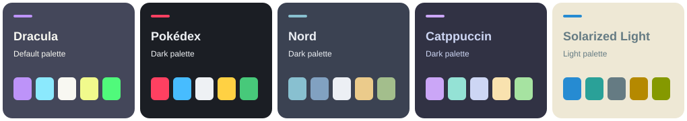

<p align="center">
  
</p>

<h3 align="center">Your Pokédex. In your terminal.</h3>

<p align="center">
  Explore Pokémon, compare stats and keep your favourites close.<br>
  All from your keyboard. On Windows, macOS and Linux.
</p>

<p align="center">
  <a href="https://github.com/Graphixa/Poke/releases/latest"></a>
  <a href="https://github.com/Graphixa/Poke/actions/workflows/ci.yml"></a>
  <a href="LICENSE"></a>
</p>

<p align="center">
  <a href="#installation">Install</a> ·
  <a href="#quick-start">Get started</a> ·
  <a href="docs/USER_GUIDE.md">User guide</a> ·
  <a href="https://github.com/Graphixa/Poke/releases">Release notes</a>
</p>

## Features

- **Explore the National Dex.** Search as you type, filter by type and open detailed Pokémon profiles.
- **Compare your next pick.** See Pokémon side by side, with stats, moves and evolution information at hand.
- **Keep your favourites.** Save Pokémon you want to return to and browse your own collection.
- **Take it offline.** Browse and look up Pokémon from a local dataset after the first download. Artwork is available offline once cached.

## Installation

**Windows · PowerShell**

```powershell
irm https://raw.githubusercontent.com/Graphixa/Poke/main/scripts/install.ps1 | iex
```

**macOS & Linux · Terminal**

```bash
curl -fsSL https://raw.githubusercontent.com/Graphixa/Poke/main/scripts/install.sh | sh
```

The installers download the latest release and verify its checksum. Follow any `PATH` instructions shown when installation finishes.

<details>
<summary>Homebrew, manual downloads and other installation options</summary>

**Homebrew · macOS**

```bash
brew tap Graphixa/homebrew-tap
brew install --cask poke
```

Prefer a manual install? Download the archive for your system from [Releases](https://github.com/Graphixa/Poke/releases/latest).

See the [installation guide](docs/INSTALLATION.md) for supported platforms, version selection, updates and building from source.

</details>

## Quick start

Open your Pokédex:

```bash
poke
```

On first launch, connect to the internet while Poke downloads its Pokémon data and guides you through artwork setup.

Type to search, use **↑ / ↓** to move and press **Enter** to explore a Pokémon. The footer shows the controls for your current view.

For a quick lookup without opening the browser:

```bash
poke pikachu --stats
poke eevee --evolution
```

[Explore the user guide →](docs/USER_GUIDE.md)

## Themes

Find a palette that feels at home in your terminal.

<p align="center">
  
</p>

```bash
poke theme
```

Preview with **↑ / ↓**, then press **Enter** to apply. Dracula is the default; choose System to use your terminal’s colours.

[Browse themes and create your own →](docs/THEMES.md)

## Documentation

| Guide | Find what you need |
| --- | --- |
| [User guide](docs/USER_GUIDE.md) | Browsing, comparisons, favourites and keyboard controls |
| [Commands](docs/COMMANDS.md) | Lookups, search, updates and everyday shortcuts |
| [Configuration](docs/CONFIGURATION.md) | Settings, artwork preferences and file locations |
| [Troubleshooting](docs/TROUBLESHOOTING.md) | Help with installation, data, artwork and updates |
| [Contributing](CONTRIBUTING.md) | Build Poke and contribute improvements |

## Credits & licence

Powered by [PokeAPI](https://pokeapi.co/). Licensed under [GPL-3.0](LICENSE).

Pokémon and Pokédex are trademarks of Nintendo / Creatures Inc. / GAME FREAK. Poke is an unofficial project and is not affiliated with them. Official artwork is downloaded to your local cache, not bundled with the app.

Terminal fireworks adapted from [erik-adelbert/firework](https://github.com/erik-adelbert/firework) ([MIT](internal/fireworks/LICENSE.MIT)).
