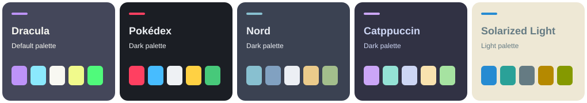

# Themes

[← Poke](../README.md) · [Configuration](CONFIGURATION.md) · [Commands](COMMANDS.md)

Choose a bundled palette or create one that fits your terminal.

## Choose a theme

```bash
poke theme
```

Use **↑ / ↓** to move through the list and preview each theme. Press **Enter** to save your choice or **Esc** to cancel. The saved theme applies when you next open Poke.

## Bundled palettes

<p align="center">
  
</p>

These swatches show colours from Poke’s bundled theme files, not app screenshots. Your terminal’s own background and colour support also affect the result.

| Theme | Configuration name | Character |
| --- | --- | --- |
| Dracula | `dracula` | Purple and cyan accents; the default |
| Pokédex | `pokedex` | Red and blue accents inspired by the handheld Pokédex |
| Nord | `nord` | Cool blue and muted tones |
| Catppuccin | `catppuccin` | Soft mauve and teal accents |
| Solarized Light | `solarized-light` | Blue and teal with a light palette |
| System | `system` | Use the terminal’s default colours |

You can also select a theme in `config.yaml`:

```yaml
theme:
  name: catppuccin
```

## Create a custom theme

1. Run `poke config path` to find your configuration directory.
2. Create a folder named `themes` beside `config.yaml`.
3. Save the following as `themes/my-theme.yaml`.

```yaml
theme_name: My Theme
style: dark

colors:
  primary: "#ff4061"
  secondary: "#47bcff"
  components: "#eef1f4"
  placeholders: "#8a96a3"
  base: "#1b1e24"
  warning: "#f1fa8c"
  error: "#ff5555"
  success: "#50fa7b"
```

All eight colour keys are required. Keep hexadecimal colours quoted so YAML does not treat `#` as the start of a comment. The spelling `colors` is part of the file format.

Run `poke theme` to find **My Theme (user)**, or select it by filename in your configuration:

```yaml
theme:
  name: my-theme
```

Use a unique lowercase filename with hyphens and the `.yaml` extension. `theme_name` controls the display name; `theme.name` refers to the filename without the extension. The `style` field identifies a `dark` or `light` palette.

## Palette keys

| Key | Intended role |
| --- | --- |
| `primary` | Main accents and emphasis |
| `secondary` | Supporting accents |
| `components` | General interface text |
| `placeholders` | Muted text and supporting detail |
| `base` | Base interface colour |
| `warning` | Warning states |
| `error` | Error states |
| `success` | Success states |

For working examples, browse the [bundled theme files](../internal/theme/themes).

## If a theme does not load

Check that the file is in the `themes` directory beside the configuration file, uses the `.yaml` extension and includes every required colour key. Invalid custom themes are skipped by the selector.

Poke resolves a selected name by checking a valid user theme first, then a bundled theme. If neither loads, it falls back to Dracula, then System. A custom theme with the same filename as a bundled one takes precedence; a unique filename makes your choice easier to identify.
